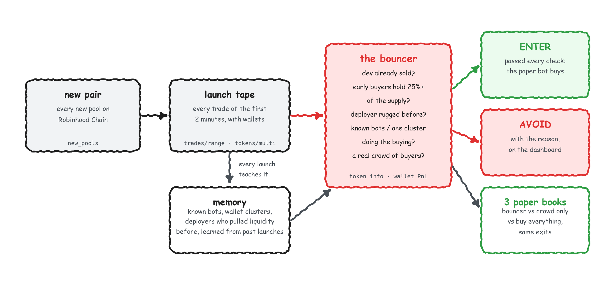

# New Pair Bouncer

A research bot that inspects each new pool on Robinhood Chain and labels it **ENTER**, **WATCH**, or **AVOID** before any paper trade is opened.

It does not broadcast transactions and it does not hold a wallet key. Paper books simulate a $100 entry so you can see whether the checks would have helped. In the recorded sample, every book still lost money. Treat the bouncer as a filter that skips the worst launches, not as a strategy that makes a profit.

Market data comes from the [CoinGecko API](https://www.coingecko.com/en/api). The checks, wallet memory, verdicts, and paper returns are computed in this repository. They are not CoinGecko fields and they are not a judgment about the person behind a wallet.



## Why the checks exist

Robinhood Chain lists hundreds of new pools an hour. In a replay of buying every new pair a few minutes after launch and holding for up to an hour, a flat $100 entry lost about 21.5% per trade. A later live paper run lost 10.8% per trade.

The losses that show up in the first two minutes are mostly about who is trading: a thin set of buyers, early wallets holding a large share of supply, a deployer whose last pools lost their liquidity, and wallets that appear at the start of launch after launch. The bouncer keeps a memory of those wallets and deployers.

CoinGecko's Robinhood Chain data arrives about 1 to 3 minutes after the block. The bot records two minutes of trading, waits for that data, and decides about six or seven minutes after launch. It is not a sniper. A short test on the same API saw Solana trades about 5 seconds behind the chain and Base about 30 seconds behind. Change `chains` and rerun the backtest before you rely on those timings.

## What it checks

Checks run from cheapest to most expensive. A pair that already fails does not spend another API call.

| Check | AVOID when | Source |
| --- | --- | --- |
| Rug ring | A wallet that bought in the first 30 seconds was early in 2 or more earlier launches, and 30% or more of those were dead within the hour | Memory plus pool trades |
| Dev sold | The developer, or the creation-block buyer, already sold in the launch window | Pool trades |
| Supply grab | Launch-window buyers still hold 25% or more of supply. A warning starts at 15% for the top 3 | Pool trades and supply |
| Deployer history | This deployer's earlier pools lost their liquidity within an hour | Memory |
| Crowd | Fewer than 15 unique buyers, or the 3 largest buyers did more than 45% of the buying | Pool trades |
| Known bots | More than 15% of buyers are wallets already labeled as round-trip or dust bots | Memory |
| Entity cluster | Half the buyers belong to one group that buys the same launches within a few blocks, or to a fresh same-block cohort | Memory plus pool trades |
| Wash trading | 90% or more of the volume comes from wallets that bought and sold within 30 seconds | Pool trades |
| Token info | Honeypot flag, or developer holding above 20%. Low GT Score and holder concentration are warnings | CoinGecko token info |
| Wallet profiles | Most of the largest buyers are wallets that have traded 3 tokens or fewer | CoinGecko wallet PnL |
| Liquidity | Less than $3,000 in the pool | CoinGecko pools |

**AVOID** means any check failed. **WATCH** means two or more warnings and no failure. **ENTER** means neither. Every threshold is in `sniper.yaml`.

## Install

Python 3.12 is required. The launch analysis uses CoinGecko `trades/range`, cursor pagination, and wallet endpoints, which means the Analyst plan or above. Create a key at [coingecko.com/en/api](https://www.coingecko.com/en/api).

From this directory:

```sh
uv venv --python 3.12 .venv
uv pip install -e ".[dev]"
cp env.example .env
```

Put `COINGECKO_API_KEY` in `.env` and set `COINGECKO_ENVIRONMENT=pro`. Do not commit the key.

## First session

Collect for 30 minutes, then open the dashboard in a second terminal:

```sh
.venv/Scripts/python -m sniper collect --minutes 30
.venv/Scripts/python -m sniper web
```

On macOS or Linux, the interpreter is `.venv/bin/python`.

`collect` prints a colored feed in a terminal: what the bot knows, each verdict and its reason, paper exits, and a status line per sweep. Redirected to a file, the same feed is plain timestamped text. The dashboard is at http://localhost:8765. It only reads `data/sniper.db`. It does not call CoinGecko and it does not see the API key.

If a collector is already running, use `python -m sniper watch`. It replays the latest verdicts from the database and spends no credits. A second collector on the same database exits and tells you to use `watch`.

Stopping and starting again resumes from the database.

## Leave it running

Windows, from this directory:

```powershell
powershell -ExecutionPolicy Bypass -File scripts/start.ps1
powershell -ExecutionPolicy Bypass -File scripts/stop.ps1
powershell -ExecutionPolicy Bypass -File scripts/install-autostart.ps1
powershell -ExecutionPolicy Bypass -File scripts/uninstall-autostart.ps1
```

`start.ps1` runs a hidden supervisor that restarts the collector if it exits. `install-autostart.ps1` registers that supervisor at login. No administrator rights are required. Collection pauses while the machine sleeps and continues when it wakes.

macOS or Linux:

```sh
make sniper-autopilot
```

That starts the collector with `nohup` and writes `data/collect.log`.

## Commands

| Command | What it does | CoinGecko credits |
| --- | --- | --- |
| `python -m sniper collect [--minutes N]` | Find new pairs, record the launch tape, run the checks, paper-trade the verdicts, and snapshot outcomes. Once an hour it refreshes memory, fetches launch info, and rewrites the report | About 20,000–30,000 a day on Robinhood Chain, capped by `max_credits_per_day` |
| `python -m sniper watch [--replay 8]` | Colored feed of the running bot. Read only | 0 |
| `python -m sniper web [--port 8765]` | Local dashboard. Read only | 0 |
| `python -m sniper backtest-bouncer [--out rows.json]` | Replay the checks over every recorded launch, using only information that was known at the time | 1 per launch, once. Minute candles are cached |
| `python -m sniper report` | Markdown report of serial snipers, bots, clusters, and outcomes | 0 |
| `python -m sniper leaderboard` | Wallets in memory, by class, and their clusters | 0 |
| `python -m sniper money` | What repeat snipers put in and took out | About 8 per wallet |
| `python -m sniper profile` | Wallet histories for launches that drew repeat wallets | About 4 per wallet |
| `python -m sniper enrich` | Token info for those launches | 1 per launch |

## Settings

`sniper.yaml` in this directory overrides the defaults in `sniper/config.py` and `sniper/checks.py`. Every key is optional.

```yaml
chains: [robinhood]          # GeckoTerminal network id: robinhood, base, eth, solana, ...
max_credits_per_day: 60000   # counted per UTC day; collection pauses past this
bouncer_enabled: true
bouncer:
  min_buyers: 15
  max_top3_buy_share: 0.45
  max_early_supply_share: 0.25
  max_bot_buyer_share: 0.15
  max_cluster_buyer_share: 0.5
  position_usd: 100
  take_profit_pct: 100
  stop_loss_pct: 50
  max_hold_min: 60
```

Paper exits use those three exit rules: take profit at +100%, stop at −50%, and a hard exit at 60 minutes. A sell is priced through the pool's remaining liquidity. A pool whose liquidity was removed pays back almost nothing, regardless of the last printed price.

## What a replay of recorded launches showed

`python -m sniper backtest-bouncer` walks launches in order. Memory for each launch uses only earlier launches, and only outcomes that were already known. The entry is the price at decision time. Exits use minute candles and the same take-profit, stop, and one-hour limit as the live books.

Snapshot: 3,644 Robinhood Chain launches over 49 hours (29 September and 1 October 2026), 2,845 with a simulated trade, free checks only, $100 per pair.

| Book | Rule | Trades | Paper return | Lost 90% or more |
| --- | --- | ---: | ---: | ---: |
| Buy everything | Every new pair | 2,845 | −35.9% | 763 |
| Crowd only | 15 or more buyers, top 3 under 45% | 1,023 | −42.9% | 382 |
| Skip the rug ring | Rug-ring check passed | 1,886 | −18.4% | 91 |
| Bouncer | ENTER only | 92 | −15.4% | 11 |

Many rugs are dead within two minutes, before a bot that waits for indexed trades can act. Of the 1,767 pools still trading at decision time, 293 were dead within the hour. The rug ring had flagged 255 of those (87%) and 211 of the 1,474 that survived (14%). A flagged pair died within the hour 55% of the time. An unflagged pair died 3% of the time. Buying all 1,767 lost 24.7% per trade. Flagged pairs lost 48.3%. Unflagged pairs lost 16.2%.

Rerun the backtest on your own database before you treat any of these figures as current.

## How to read the data

- A launch is a token's first pool. Later pools of the same token, including other fee tiers and post-graduation pools, are skipped. A pool that starts trading minutes after it is created is timed from its first trade.
- Some router and hook calls report a buy and a sell for the same sender in one transaction. The bot keeps the larger side.
- A trade is attributed to the transaction sender. ERC-4337 bundlers, addresses starting with `0x4337`, are set aside because they submit other users' trades.
- In this sample, the rug ring, a thin crowd, deployers with dead pools, and supply held by the first buyers marked the worst launches. A developer who had already sold was a weak predictor on its own. Wash trading and wallet clusters marked launches whose volume was not lasting demand.
- Minutes after launch, GT Score is usually low, honeypot status is often unknown, and holder counts are often empty. That is why the early checks use trades and wallets.

## Also in this repository

The original CoinGecko onchain-signal-bot paper trader is still here under `bot/` and `strategies/`. The shared HTTP client in `core/client.py` retries HTTP 5xx responses and bounds its in-memory cache for long runs. See [docs/onchain-signal-bot.md](docs/onchain-signal-bot.md).

## Links

<!-- coingecko-links:start -->
- CoinGecko API: https://www.coingecko.com/en/api
- Pricing: https://www.coingecko.com/en/api/pricing
- Docs: https://docs.coingecko.com
- Agent Skill + MCP: https://docs.coingecko.com/ai-integration
<!-- coingecko-links:end -->
